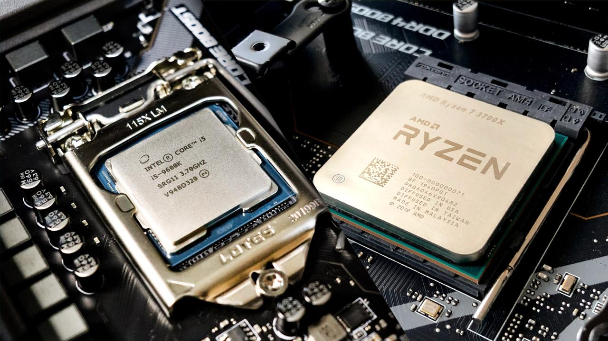
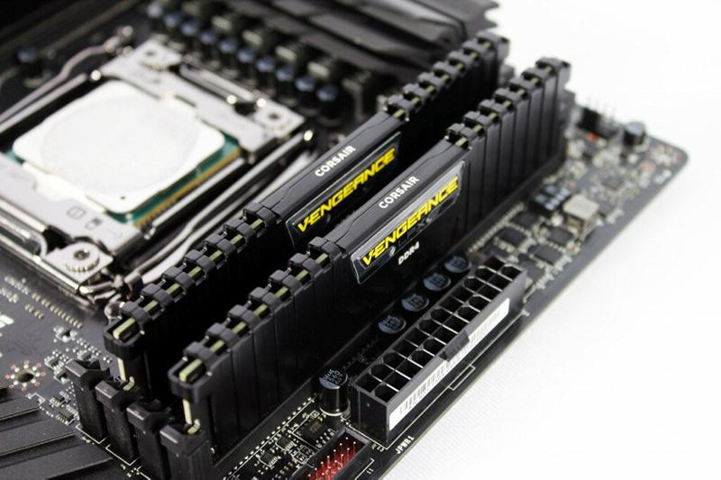
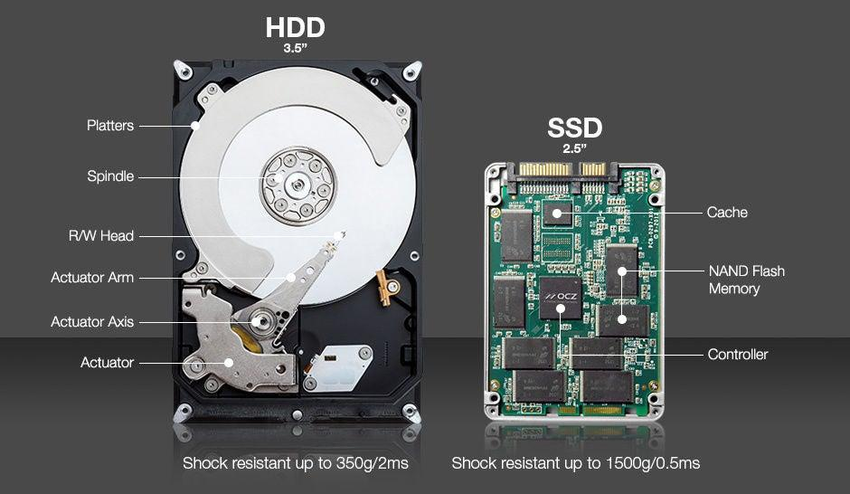
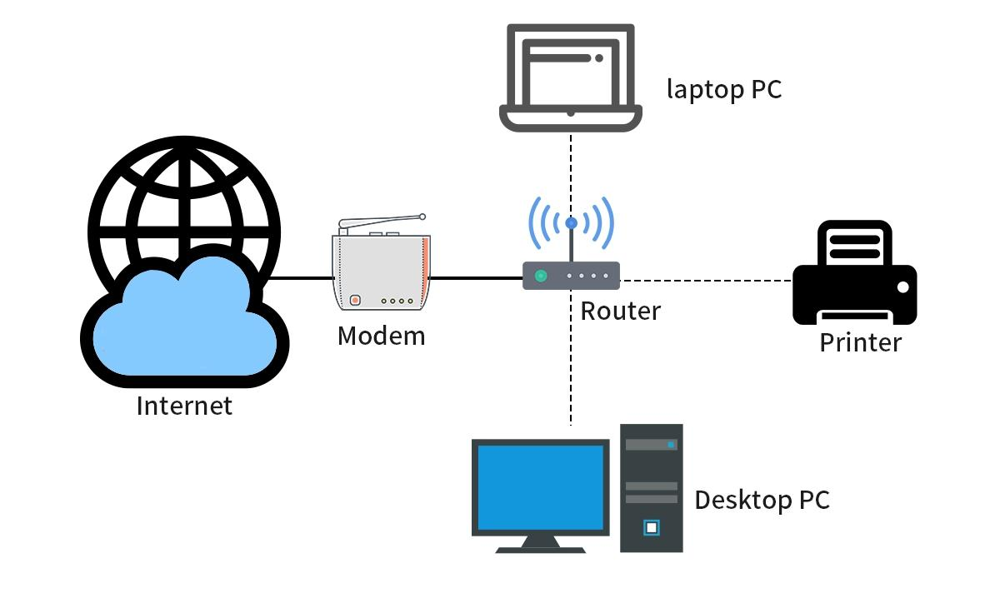
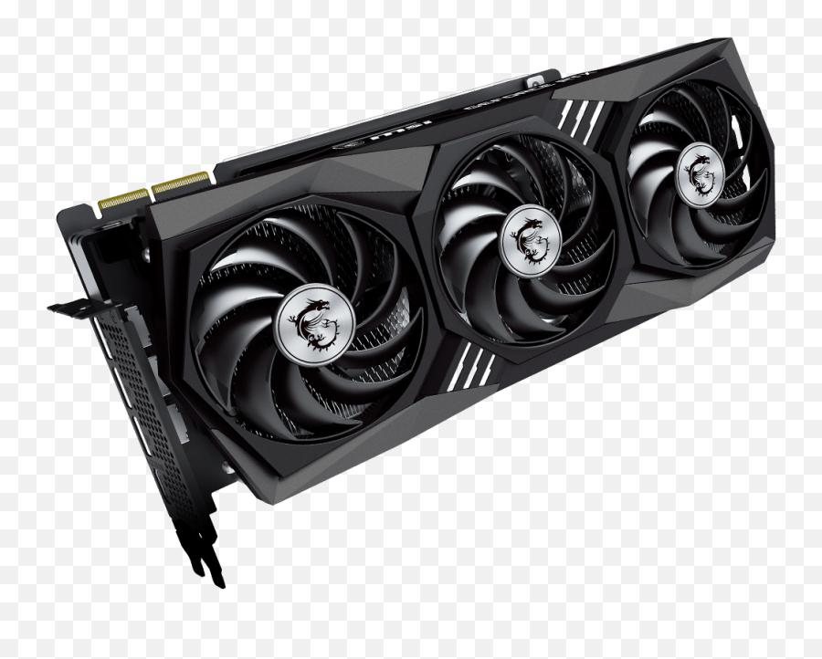

<!DOCTYPE html>
<html lang="en">
<head>
    <meta charset="UTF-8">
    <meta name="viewport" content="width=device-width, initial-scale=1.0">
    <title>obsan computer</title>
    <link rel="stylesheet" href="obsan.css">

</head>
<body>
    <header>
    <h1>💻 OBSAN COMPUTER COMPONENT WEBSITE</h1>
    
Learn Everything About Computers

    <H2>HI WELCOME</H2>
</header>

<nav>
    <a href="#">Home</a>
    <a href="#">About</a>
    <a href="#">Components</a>
    <a href="#">Gallery</a>
    <a href="#">Contact</a>
</nav>

<section class="hero">

    

    <h2>What is a Computer?</h2>

    

        A <strong>Personal Computer (PC)</strong> is an electronic device used
        for learning, working, browsing the internet, programming, gaming,
        designing, and many other tasks. A computer contains hardware such as
        the CPU, RAM, storage, motherboard, keyboard, mouse, and monitor. It
        also runs software like Windows, Microsoft Office, web browsers, and
        many useful applications.
    

    <a href="https://en.wikipedia.org/wiki/Computer" class="button">Learn More</a>

</section>

<section class="features">

    

        
        <h3>🖥️ CPU</h3>
        
What is a CPU?

The CPU is the brain of a computer. It processes instructions, performs calculations, and controls many computer operations.

Main functions:
- Executes programs and applications.
- Performs mathematical calculations.
- Processes instructions.
- Helps run games and software.
Important CPU specifications:
- Cores: Processing units inside the CPU.
- Threads: Tasks the CPU can handle simultaneously.
- Clock speed: How fast the CPU operates, usually measured in GHz.
Example: Intel Core i3, Intel Core i5, AMD Ryzen 5.

    

    

        
        <h3>💾 RAM</h3>
        
RAM is the computer's temporary working memory. It stores information that the CPU needs to access quickly while programs are running.

Main functions:
- Helps run multiple applications.
- Makes switching between programs smoother.
- Temporarily stores active program data.
- Helps improve multitasking performance.
RAM capacities:
RAM	Typical use
4 GB	Basic tasks
8 GB	Everyday use
16 GB	Programming and multitasking
32 GB	Heavy workloads
64 GB	Professional workloads

Important: RAM is temporary. Its contents are cleared when the computer shuts down.

    

    

        
        <h3>💽 Storage</h3>
        
What is storage?

Storage is where your computer permanently saves files, applications, pictures, videos, and operating system files.

There are two common types:

HDD (Hard Disk Drive)
- Uses spinning magnetic disks.
- Usually cheaper for large capacities.
- Generally slower than SSDs.
SSD (Solid State Drive)
- Uses flash memory.
- Faster file access.
- Faster Windows startup.
- No spinning disks.
Feature	HDD	SSD
Speed	Slower	Faster
Noise	Can make noise	Silent
Durability	More sensitive to shocks	More resistant to shocks
Price per GB	Usually cheaper	Usually more expensive

    

    

        
        <h3>🌐 Internet</h3>
        
What is the Internet?

The Internet is a worldwide network that connects computers, phones, servers, and other devices so they can communicate and exchange information.

Main uses:
- Browsing websites.
- Watching YouTube videos.
- Sending emails.
- Downloading files.
- Playing online games.
- Communicating with people worldwide.
Important Internet specifications:
Term	Meaning
Mbps	Internet speed
Download	Receiving data
Upload	Sending data
Ping	Network response time
Wi-Fi	Wireless network connection
Router	Connects your devices to a network

    
    

        
        <h3>🎮GPU</h3>
        
# GPU (Graphics Processing Unit)

## What is a GPU?

A GPU (Graphics Processing Unit) is an important computer component responsible for processing and rendering images, videos, animations, and 3D graphics. It is designed to perform many calculations simultaneously, making it especially useful for graphics-intensive tasks.

A GPU helps display visual content smoothly on a computer screen and improves performance in gaming, video editing, 3D modeling, and artificial intelligence applications.

## Functions of a GPU

- **Graphics Rendering:** Processes and displays images, animations, and 3D graphics.
- **Gaming:** Improves game performance, visual quality, and frame rates.
- **Video Editing:** Accelerates video processing, effects, and rendering.
- **3D Modeling:** Helps create and render 3D objects and animations.
- **Artificial Intelligence:** Accelerates certain machine-learning and AI calculations.

## Types of GPU

### 1. Integrated GPU (iGPU)
An integrated GPU is built into a CPU or processor package. It usually shares the computer's main RAM and is suitable for everyday tasks, watching videos, and basic graphics processing.

### 2. Dedicated GPU (dGPU)
A dedicated GPU is a separate graphics processor, usually installed as a graphics card. It has its own video memory (VRAM) and provides greater graphics performance for demanding applications.

## Important GPU Specifications

- **VRAM:** Dedicated video memory used to store graphics data.
- **Clock Speed:** The operating frequency of the GPU.
- **Memory Bandwidth:** The amount of data transferred between GPU memory and the processor.
- **CUDA Cores / Stream Processors:** Parallel processing units used for calculations.
- **Power Consumption:** The electrical power required to operate the GPU.

## Popular GPU Manufacturers

- NVIDIA GeForce
- AMD Radeon
- Intel Arc

## Why is a GPU Important?

A GPU is important because it handles graphics-related calculations efficiently. It allows computers to run modern games, edit high-resolution videos, create 3D designs, and perform demanding visual computing tasks.

**In simple terms:** The CPU handles general computer instructions, while the GPU specializes in graphics processing and parallel calculations.

    

</section>

<footer>
    <h3>© 2026 Obsan Computer Website</h3>
    
Designed with HTML & CSS by Obsan

</footer>

</body>
</html>

